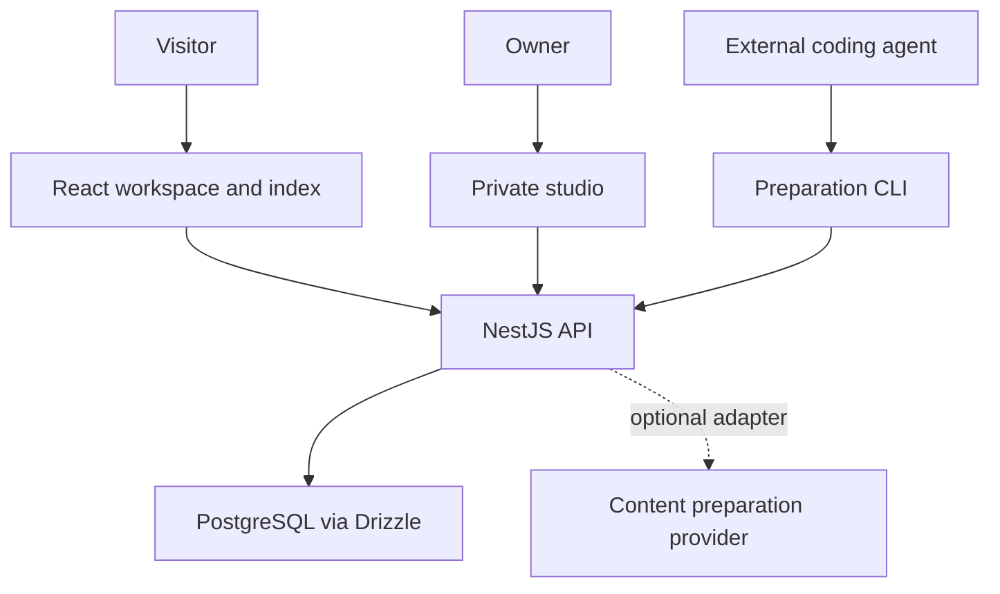
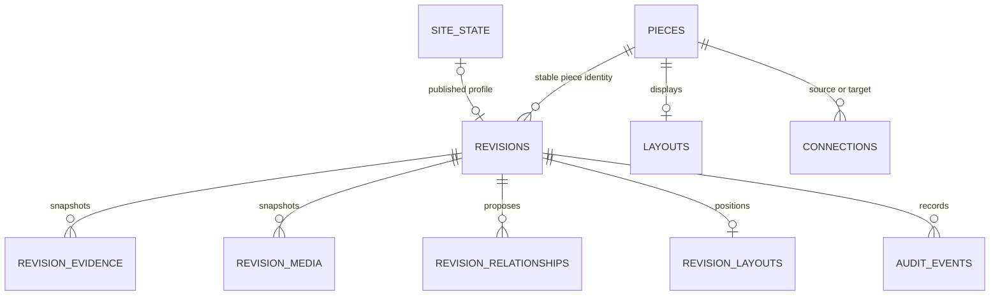
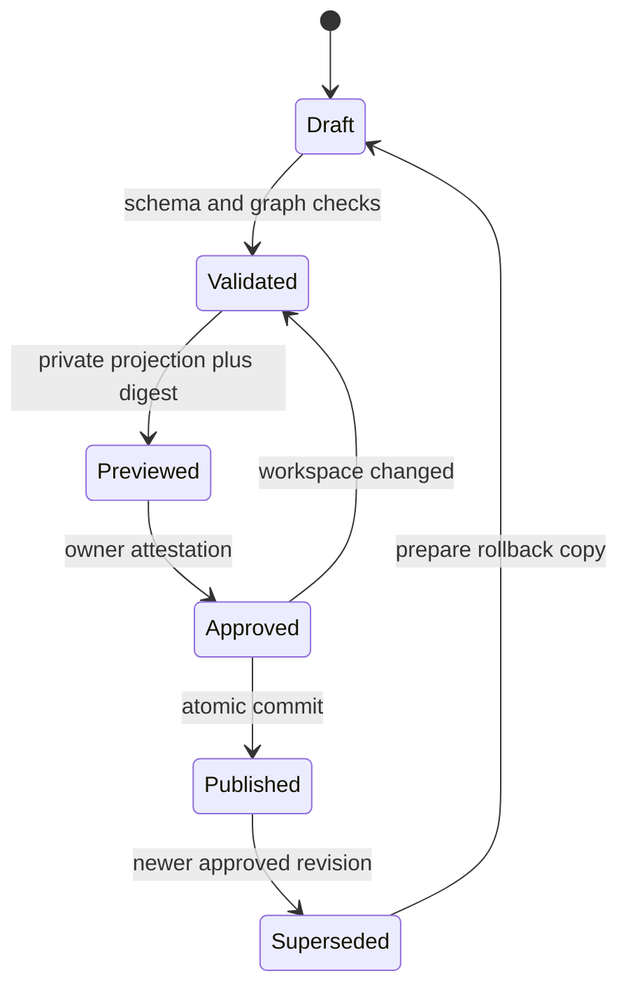

# Architecture

## System context

Visitors read published work. The owner and an authorized external coding agent can prepare private revisions. Only the owner can approve or publish. A live AI provider is optional; the browser never accesses PostgreSQL directly.

Stable creation identity is independent of visual position or composition. A child can contribute to multiple parents without becoming multiple copies.

## Frontend

`App` loads published data or displays an honest connection error. The real collection starts empty; `sampleWorkspace` is opt-in and has a persistent demonstration banner. Sample interaction never writes to the API.

React Flow provides panning, wheel/pinch zoom, focus semantics, edges, and minimap. Custom nodes supply the visual identity. Detail levels change below zoom 0.45, between 0.45 and 0.8, and above 0.8. Memoized nodes/edges and visible-element rendering reduce unnecessary work. The studio is lazy-loaded.

`arrangedPositions` computes temporary radial positions for descendants. It does not mutate stored layout. Reassembly restores saved positions and the previous viewport. All pieces stay available through the index. Native dialogs support focus containment and Escape. Details safely render text, links, images, videos, evidence, and allowlisted opt-in previews.

## Backend modules

| Module          | Responsibility                                                             |
| --------------- | -------------------------------------------------------------------------- |
| Core            | Environment validation, database connection, authorization                 |
| Portfolio       | Read models, immutable drafts, graph projection, transactional publication |
| Publishing      | Private workflow HTTP routes                                               |
| Preparation     | Replaceable evidence-to-proposal provider                                  |
| Common boundary | Validation pipes, errors, request IDs, logs, rate limiting                 |

A modular monolith keeps publication in a single transaction. Splitting services now would add distributed-consistency work without a demonstrated requirement. Controllers validate/delegate; services implement domain rules; repository helpers build SQL read models.

## Database

The diagram's revision-to-piece entity association is logical and enforced by service code because the same revision table supports profiles. Published pointers and graph endpoints have actual foreign keys. Per-entity JSON bodies hold scalar/text content and technologies; evidence/media/relationships/positions have normalized tables. No whole-workspace JSON blob is stored.

`pieces.published_revision_id` selects the live content. `site_state.version` increments on every publication, including profiles. A trigger prevents modifying immutable body/identity fields; limited application permissions prevent rewriting evidence snapshots. Layout updates are content revisions. Connection IDs remain deterministic for the same source/target/type.

## Workflow and concurrency

Previewed is represented by a stored preview digest on a validated revision, not a separate status. SHA-256 binds the revision ID, hydrated immutable content, and workspace version. Approval requires the exact digest plus `verified: true`. Publication rechecks the digest, current base, and graph in a locked transaction.

All mutations take the same PostgreSQL advisory transaction lock. A publication updates the live pointer, position, outgoing edges, old revision status, workspace version, and audit record atomically. Concurrent approvals against one version cannot both publish: the later commit must be reviewed again. A rollback is a newly approved revision, not a destructive history rewrite.

Public reads use repeatable-read transactions to avoid mixing graph versions. Public projection removes private evidence and every review note before responding.

## Relationships

| Type         | Direction and meaning                    | Rule                        |
| ------------ | ---------------------------------------- | --------------------------- |
| contains     | Container → constituent                  | Cluster/project source only |
| reuses       | Consumer → reused creation               | Structural DAG              |
| depends_on   | Dependent → dependency                   | Structural DAG              |
| evolves_from | New distinct creation → earlier creation | Structural DAG              |
| inspired_by  | Creation → influence                     | May be cyclic               |

All structural types, including contains, share one acyclic graph. Self-reference and duplicate typed edges are rejected. Targets must already be published. Updating a source preserves incoming edges and replaces its outgoing edges with the approved complete set.

## API and trust boundaries

`docs/API.md` maps routes; Swagger documents request schemas. Public reads require no token. Agent/owner credentials permit private reads and preparation. Owner credentials are required for approval/publication/audit. Input errors return 400, authentication 401, role denial 403, missing data 404, stale workflow 409, oversized bodies 413, and rate limiting 429.

`ContentPreparationProvider` receives supplied facts and the workspace and returns a proposal with review notes. The default implementation copies known facts and suggests an empty position. It does not inspect a repository, infer technologies/relationships, execute code, or call a model. External agents may inspect authorized files outside the running site and submit proposals through the same API. A future provider cannot bypass approval.

## Operations

Development uses Vite's same-origin proxy. Production uses Caddy for static assets, same-origin `/api` routing, and HTTPS. The migration job gets administrator DB credentials. The API gets the limited application role. Secrets are server-side runtime variables, never frontend build inputs.

Rate limiting is in process for one API instance. Native role connectivity, Docker/Caddy, hosting, and browser behavior require staging verification. See `docs/VERIFICATION.md`; none is claimed from build success alone.
